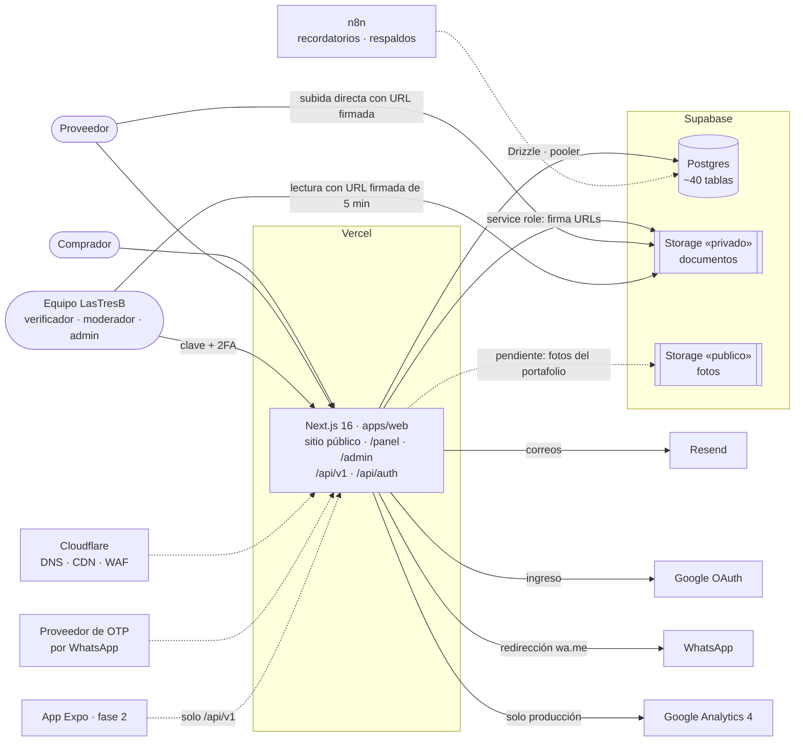
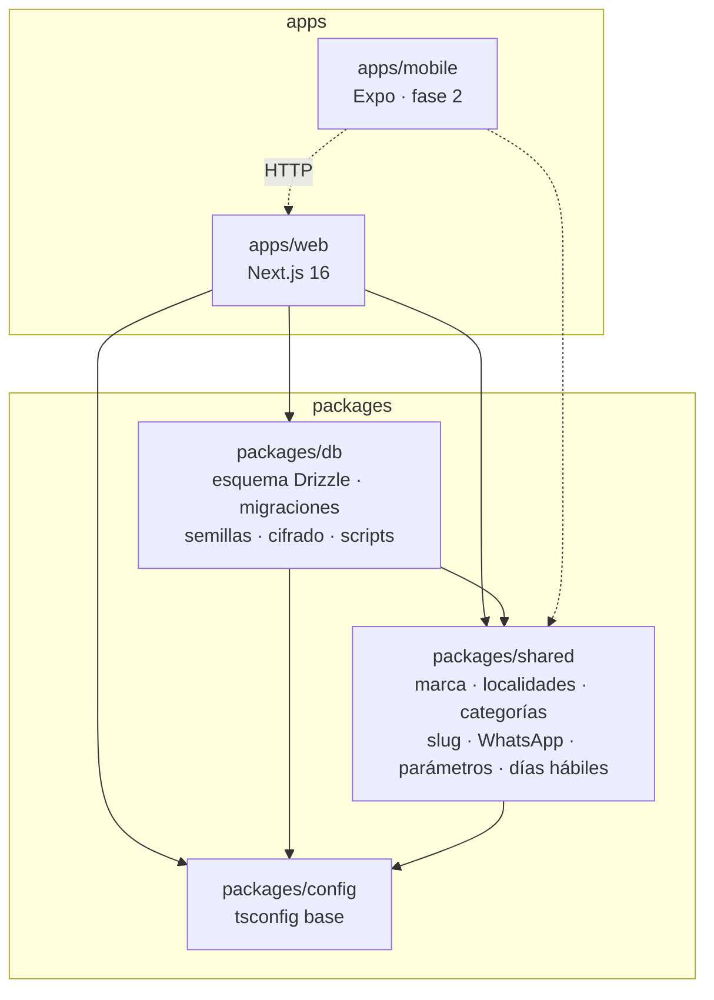
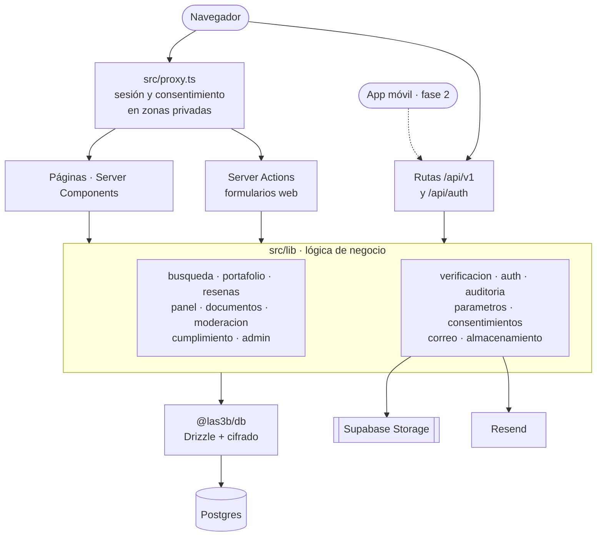
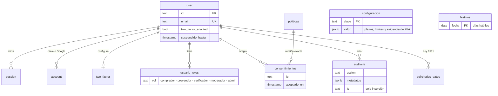
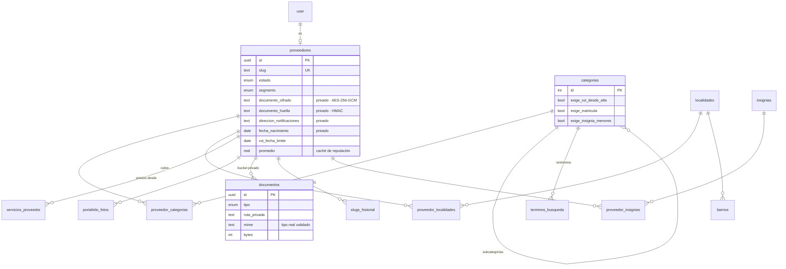
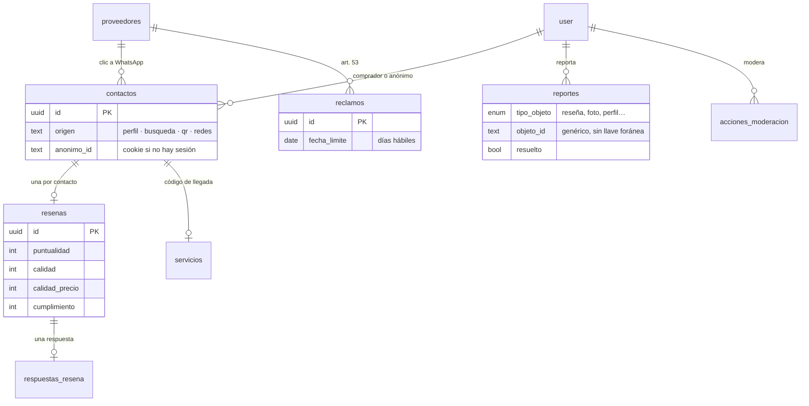
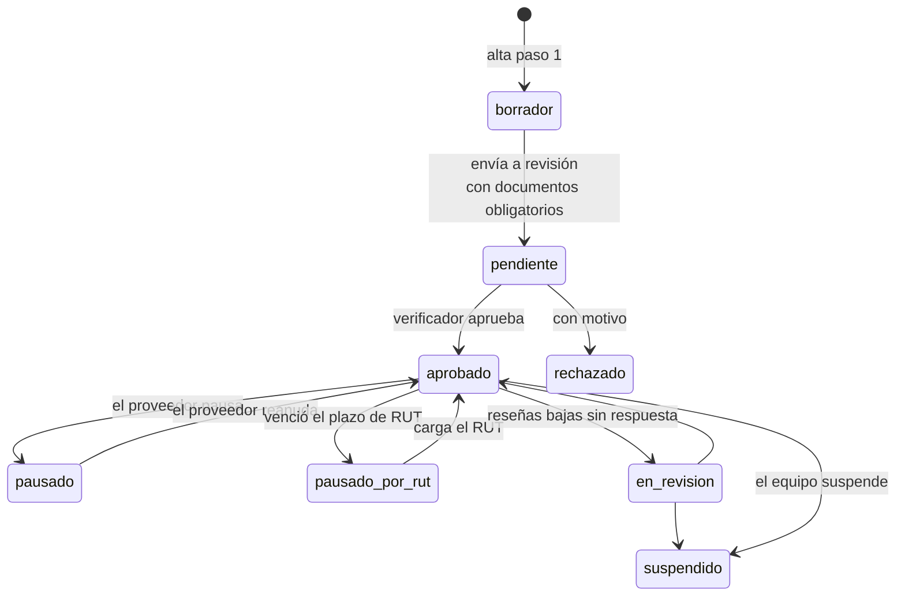
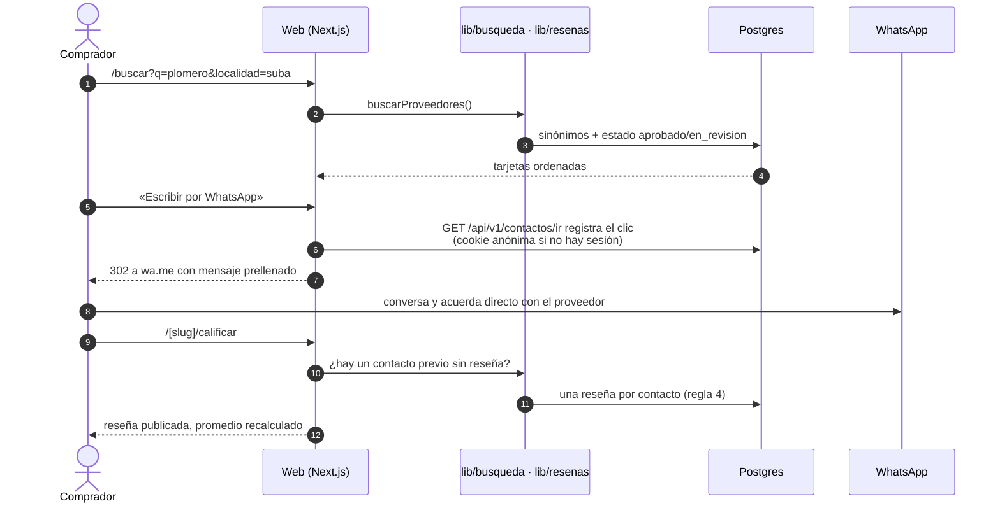
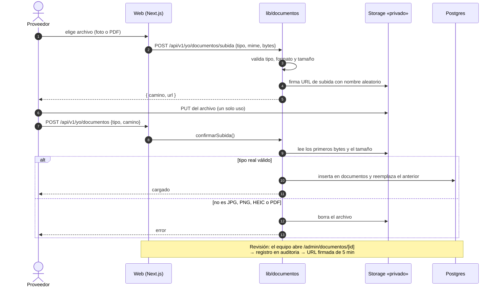
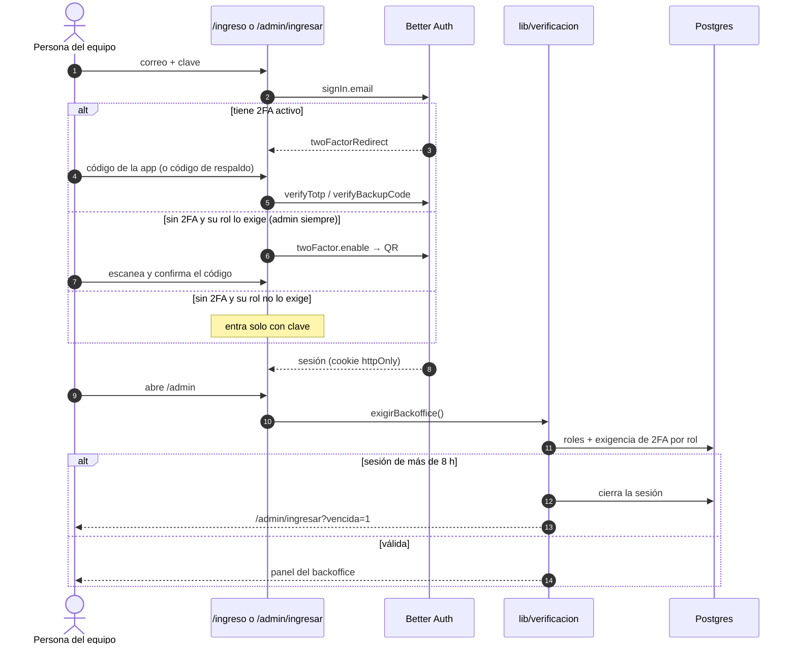

# Diagramas de arquitectura

Diagramas como código en [Mermaid](https://mermaid.js.org): se editan como texto y se dibujan solos.

**Cómo verlos**

- **GitHub:** abre este archivo en el repositorio; los dibuja directamente.
- **VS Code:** instala la extensión *Markdown Preview Mermaid Support* (`bierner.markdown-mermaid`) y abre la vista previa con `Ctrl+Shift+V`.
- **En el navegador:** copia un bloque en [mermaid.live](https://mermaid.live) para verlo, editarlo y exportarlo a PNG o SVG.
- **Imágenes SVG:** `pnpm docs:diagramas` regenera los SVG de `docs/diagramas/` (útiles para el Drive o presentaciones).

Convención: línea continua = existe hoy; **línea punteada = planeado, aún no construido**. Actualizado al 29 oct 2026.

---

## 1. Contexto e infraestructura

Quién usa el sistema y con qué servicios externos habla.

## 2. Monorepo

Qué paquete depende de cuál. La app móvil nunca habla con la base: solo con `/api/v1`.

## 3. Capas dentro de `apps/web`

Regla 7: la lógica de negocio vive en `lib/`. Las páginas, las Server Actions y las rutas `/api/v1` solo la llaman, para que la app móvil use exactamente lo mismo.

## 4. Datos: cuentas, permisos y cumplimiento

El esquema completo está en `packages/db/src/schema/`. `auditoria` solo admite inserciones (regla 3) y los consentimientos apuntan a la versión exacta de cada política (regla 5).

## 5. Datos: proveedores y catálogo

Los campos marcados como privados nunca salen en el portafolio ni en la API pública (regla 1).

## 6. Datos: contacto, reseñas y reclamos

Una reseña por contacto, y solo si hubo un clic previo a WhatsApp (regla 4).

## 7. Estados del proveedor

Solo `aprobado` y `en_revision` aparecen en la búsqueda (regla 6). `pausado` muestra «no disponible»; `suspendido` y `rechazado` dan 404.

## 8. Flujo: buscar, contactar y calificar

## 9. Flujo: subida de un documento privado

El archivo nunca pasa por Vercel (límite de 4,5 MB por petición): va directo al bucket con una URL de un solo uso, y el servidor lo valida antes de registrarlo.

## 10. Flujo: ingreso del equipo al backoffice

